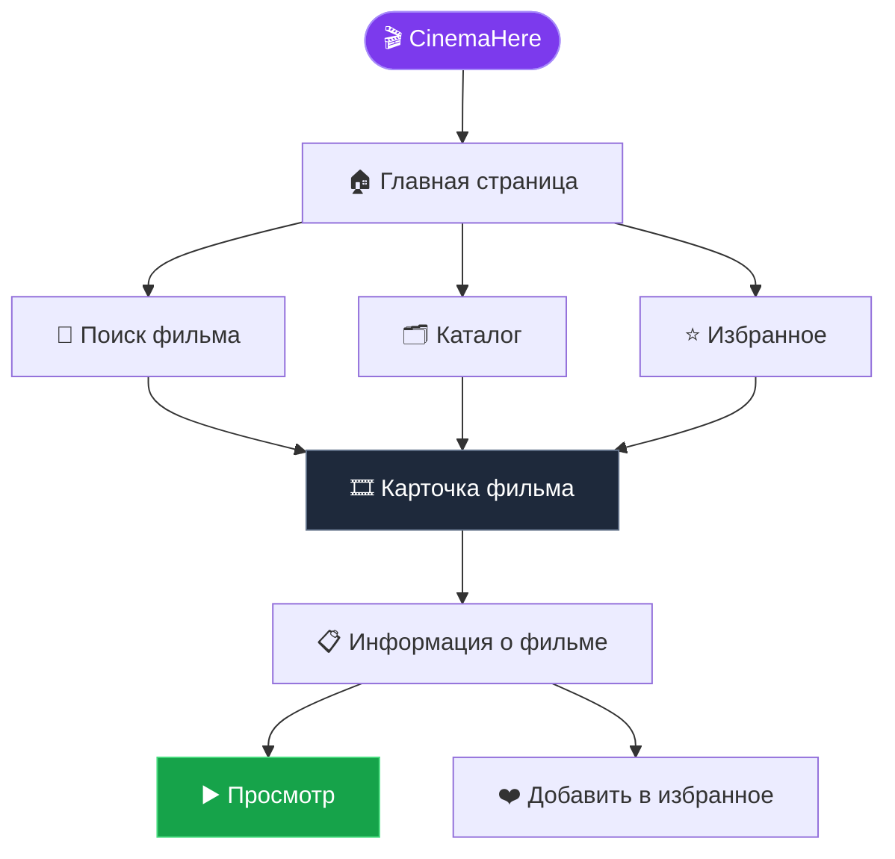
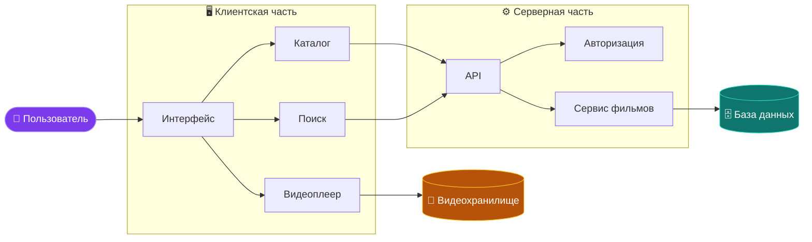
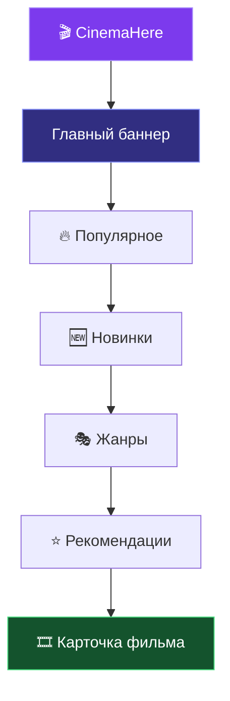
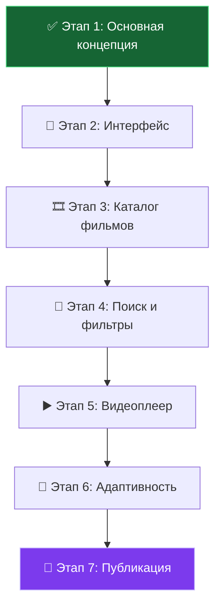

<div align="center">

# 🎬 CinemaHere

### Твой мир кино — в одном месте.

**Смотри. Выбирай. Наслаждайся.**

Современный онлайн-кинотеатр, созданный для тех, кто любит фильмы, сериалы и незабываемые истории.

<br>


<br>

**🍿 Большой выбор · 🎥 Удобный просмотр · 🌙 Атмосфера кино**

</div>

---

## 📽️ О проекте

**CinemaHere** — проект онлайн-кинотеатра, цель которого — объединить любимые фильмы и сериалы в удобном и стильном интерфейсе.

Мы стремимся создать пространство, где пользователь сможет легко находить интересный контент, знакомиться с новинками и выбирать, что посмотреть сегодня вечером.

### ✨ Главная идея

> Хорошее кино начинается с правильного выбора.

CinemaHere — это не просто каталог фильмов. Это концепция современного кинопространства, в котором дизайн, удобство и атмосфера работают вместе.

---

## 🎞️ Возможности проекта

| Возможность              | Описание                                                  |
| :----------------------- | :-------------------------------------------------------- |
| 🎬 Каталог фильмов       | Просмотр доступных фильмов и сериалов                     |
| 🔎 Поиск                 | Быстрый поиск интересующего контента                      |
| 🗂️ Категории            | Разделение контента по жанрам                             |
| ⭐ Избранное              | Сохранение интересных фильмов                             |
| 📱 Адаптивный дизайн     | Удобство на компьютерах, планшетах и телефонах            |
| ▶️ Просмотр              | Переход к просмотру доступного видеоконтента              |
| 🎨 Современный интерфейс | Визуальный стиль, вдохновлённый стриминговыми платформами |

*Список описывает планируемые возможности. Фактическая реализация зависит от текущего состояния проекта.*

---

## 🧭 Как устроен CinemaHere?

Основной пользовательский сценарий можно представить в виде следующей схемы.



---

## 🏗️ Архитектура проекта

Упрощённая схема показывает, как основные части онлайн-кинотеатра могут взаимодействовать друг с другом.



*Это пример возможной архитектуры, а не утверждение о том, что все перечисленные компоненты уже реализованы.*

---

## 🛠️ Технологии

Технологический стек зависит от реализации проекта.

Возможный набор инструментов:

<div align="center">


</div>

* **HTML5** — структура страниц.
* **CSS3** — оформление, анимации и адаптивность.
* **JavaScript** — интерактивность и логика интерфейса.
* **Git** — контроль версий.
* **GitHub** — хранение исходного кода и совместная работа.

---

## 🚀 Запуск проекта

### 1. Клонирование репозитория

```bash
git clone <URL_ВАШЕГО_РЕПОЗИТОРИЯ>
```

### 2. Переход в папку проекта

```bash
cd CinemaHere
```

### 3. Запуск

Если проект использует обычные HTML, CSS и JavaScript:

1. Открой папку проекта в Visual Studio Code.
2. Найди файл `index.html`.
3. Открой его в браузере или запусти через расширение Live Server.

Если проект использует сервер, сборщик или дополнительные зависимости, следуй инструкциям соответствующего инструментария.

[тест](./assets/2.avif)

---

## 📂 Структура проекта

Пример организации файлов:

```text
CinemaHere/
│
├── index.html
├── README.md
│
├── css/
│   └── style.css
│
├── js/
│   └── script.js
│
├── images/
│   ├── logo.png
│   ├── banners/
│   └── posters/
│
└── assets/
    ├── icons/
    └── fonts/
```

> Структура приведена для примера. Названия папок и файлов нужно адаптировать под реальный репозиторий.

---

## 🎨 Дизайн-концепция

Визуальный стиль CinemaHere строится вокруг атмосферы настоящего кинотеатра.

* 🌑 **Тёмная тема** — комфортный просмотр и акцент на постерах.
* 💜 **Яркие акценты** — узнаваемый визуальный стиль.
* 🖼️ **Крупные постеры** — визуально привлекательный каталог.
* ✨ **Плавные анимации** — приятное взаимодействие с интерфейсом.
* 📐 **Адаптивная сетка** — удобное отображение на разных устройствах.

### 🖥️ Концепция пользовательского интерфейса



---

## 🗺️ План развития



*Это предполагаемый план разработки. Отмечай этапы выполненными по мере реализации.*

---

## 🤝 Участие в разработке

Хочешь предложить улучшение или сообщить об ошибке?

1. Сделай Fork репозитория.
2. Создай отдельную ветку для изменений.
3. Внеси необходимые изменения.
4. Создай Pull Request с описанием своей работы.

При командной разработке старайся использовать понятные названия веток и коммитов.

---

## 📌 Важная информация

CinemaHere — проект онлайн-кинотеатра, предназначенный для разработки и демонстрации возможностей веб-технологий.

При публикации фильмов и сериалов необходимо соблюдать авторские права и использовать только тот контент, на распространение которого есть соответствующее разрешение.

---

## 👨‍💻 Авторы

**CinemaHere Development Team**
Николаев Максим, Витвиций Иван, Марк Панкратов.

Создано с ❤️ и любовью к кино.

---

<div align="center">

### 🍿 Что будем смотреть сегодня?

**CinemaHere — твой следующий любимый фильм начинается здесь.**

⭐ Если проект тебе понравился, поставь репозиторию Star!

[тест](./assets/1.avif)

</div>
